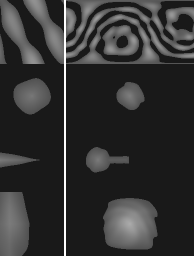

# pixel-world-generator

Seeded world map generator. 1 px = 1 m. Python.

Same seed + same generator version = same world.

## Direction and current status

Terrain, water and the interactive terminal interface are implemented. The CLI and Python API support
persistent world projects, coarse overviews and aligned regional terrain exports: start with a
whole-world overview or only a needed region, save the project, then generate more areas of the
same world without changing existing terrain.
An island is a geography choice; the existing standalone command keeps its island default.
World commands support overview selection by pixel coordinates and direct regional exports.
The interactive terminal form continues to generate standalone maps.

See [the roadmap](openspec/roadmap.md) and
[world project proposal](openspec/changes/planetary-world-regions/proposal.md).
World-linked water requires a separate continuity design before the remaining stages: biomes,
settlements, roads and bridges, then borders. Existing downstream proposals target single maps.

## Usage

```sh
make generate SEED=42 SIZE=256          # writes terrain, water and metadata layers
make generate SEED=42 OUT=out/island42  # SIZE defaults to 1024
make interactive                       # configure and preview with a terminal form
make generate SEED=42 ARGS="--sea-level 0.3 --river-threshold 128"
```

`--seed` is required. `--height-range` (default 400) is how many metres the full 16-bit range
spans; it affects water depths but not terrain pixels. Same seed, generator version and parameters give byte-identical files on the
same platform; `metadata.json` records the seed, generator version and every parameter.
`heightmap.png` is 16-bit grayscale, 1 px = 1 m; `heightmap.r16` holds the same values as a
headerless little-endian uint16 raw file (row-major, top row first), the format Godot terrain addons
import as R16/RAW; `preview.png` is the same image in 8 bits.

`make interactive` opens a keyboard- and mouse-accessible form. Tab moves between fields;
choose a size preset or enter a custom size, enter a seed, and review the explained settings.
Select Generate to review the seed, size and output path before writing; existing generated files
require explicit confirmation before replacement. The layer selector offers existing terrain and
water images for terminal preview or opening in the system viewer. Generation runs in the background.

## Terrain

Fractal noise, an island mask, then grid erosion (stream-power incision along D8 flow plus thermal
relaxation). Preview of seed 42 at 512 px, 50 erosion iterations: `docs/terrain-seed42.png`.

Erosion defaults (`erosion_strength=0.04`, `erosion_talus=0.004`, 50 iterations) were tuned by eye
on seed 42. Stronger values (about 0.1) flatten basins into plateaus.

Measured on one machine, seed 42, 50 iterations: 512 px about 2 s, 1024 px 9.6 s, 2048 px 48 s.
Erosion dominates and grows with pixel count, so 4096 px is expected to take minutes.

## Changelog and releases

Every PR adds an English Markdown fragment in `changelog.d/`: `<issue>.added.md`,
`<issue>.changed.md`, `<issue>.fixed.md` or `<issue>.removed.md`. Without an issue use a unique
name such as `+release-automation.added.md`. Do not edit generated changelog entries by hand.

```sh
make changelog-draft                       # preview only
make changelog-check TARGET_BRANCH=main    # compare against origin/main
make release-check                        # validate local release prerequisites
make build                                # wheel and sdist in dist/
```

Fetch the target branch before checking fragments. The `Checks and changelog` Actions job runs
`make check` and checks fragments against the actual PR base, including stacked PRs. Configure
it as a required check in branch protection if merges must be blocked on failure.

To release, first merge the intended version in both `pyproject.toml` and
`src/pixel_world/__init__.py` (format `X.Y.Z`). Algorithm changes require a generator version
bump. In GitHub Actions, manually run **Release** on **main**. The workflow runs checks, consumes
fragments into `CHANGELOG.md`, commits that change, atomically pushes main and tag `vX.Y.Z`, and
creates a GitHub Release with wheel and sdist attachments. Existing tags are never overwritten.
Nothing is published to PyPI. Local changelog assembly is `make changelog-build`.

The workflow uses the built-in `GITHUB_TOKEN` with `contents: write`; repository rules must
permit its release commit on main. No additional secret is needed. A concurrent update to main
causes publication to fail without overwriting the newer commit.

If the commit and tag were pushed but GitHub Release creation failed, keep the tag. Check out
that tag in a clean checkout, rebuild with `make build`, copy its changelog section to a notes
file, and finish the release (replace the example version):

```sh
gh release create v0.1.0 dist/* --verify-tag --title v0.1.0 --notes-file release-notes.md
```

If the release already exists but an upload failed, attach the missing files with
`gh release upload v0.1.0 dist/*` instead. Do not rerun the full workflow or move the tag.

## Water

The water datum defaults to `sea_level=0.2`, a fraction of `height_range_m` in the
range [0, 1). Metadata records `sea_level_m` in metres above the encoded height
minimum; sea-relative elevation is height in metres minus this datum. The default
`min_lake_depth_m=1.0` is a minimum retained depth in metres (non-negative).
`water.png` is an aligned 8-bit grayscale category layer: 0 dry, 1 sea, 2 lake,
3 river. Metadata records this legend and all controls. Set the datum and lake
depth with `--sea-level` and `--min-lake-depth`; set the positive integer river
threshold in square metres and maximum width in pixels with `--river-threshold`
and `--max-river-width`. Pass these options through `ARGS` as shown above.

River centrelines start at a contributing area of 256 m² by default. Each cell
counts itself and all upstream cells exactly. The display widens channels in
steps based on the base-2 logarithm of area divided by the threshold, capped by
`max_river_width` (default 9 pixels). This is a map symbol, not an excavated bed
or a hydraulic simulation. Sea and lakes take precedence over the symbol.

Run `make water-benchmark` to measure seed 42 at 1024 and 2048 and write
`out/water-preview-1024.png` and `out/water-preview-2048.png`. These diagnostic
images show sea in dark grey, lakes in light grey and rivers in white over the
terrain. Reference run on Linux x86-64, Intel i7-13800H, Python 3.13.8 and
NumPy 2.3.3, default parameters (peak RSS covers the complete process):

| Size | Terrain | Water | Peak RSS |
| --- | ---: | ---: | ---: |
| 1024 | 11.65 s | 6.13 s | 131.0 MiB |
| 2048 | 52.81 s | 24.38 s | 398.7 MiB |

## License

MIT, see `LICENSE`.

## World project foundation

The world-project API provides persisted definitions, coordinate conversions and coarse overviews.
Regional terrain exports and the world/region CLI remain planned. The
existing `make generate` and `make interactive` workflows still generate standalone islands.

A project contains:

- `world.json`: the immutable definition and its SHA-256 `world_id`. It records the seed,
  generator/schema/coordinate versions, geometry, metre dimensions or radius, starting extent and geography,
  vertical minimum/range, absolute sea datum, overview resolution and numeric generation parameters.
  Numeric parameters remain reserved configuration; the current coarse field has fixed, versioned rules.
- `coverage.json`: separately versioned, canonically ordered completed areas and relative artifact
  paths with SHA-256 hashes. Adding coverage checks completed artifact hashes, preserves existing
  records and atomically replaces only this index. An area's own metadata will locate its bounds
  and projection when regional export is implemented.

Developer API (no raster is required to create or reopen a project):

```python
from pathlib import Path
from pixel_world.world import WorldDefinition
from pixel_world.writer import create_project, load_project

world = WorldDefinition(
    seed=42,
    geometry="flat",
    geography="region",
    width_m=16_000_000,
    height_m=16_000_000,
    boundary="wrap_x",
)
project = create_project(Path("out/story-world"), world)
project = load_project(Path("out/story-world"), expected=world)
position = project.definition.flat_position(-1, 200)  # (15_999_999, 200) metres
```

For a sphere use `geometry="sphere"`, `radius_m=6_000_000`, and leave planar dimensions absent.
The `bounded` boundary field is unused for spheres; spheres have no physical boundary. Flat
worlds accept `bounded` or east-west periodic `wrap_x`; y never wraps. Flat positions are in
half-open `[0, width_m)` and `[0, height_m)` intervals, with origin at top left, x right and y down.
Geography must be explicit (`world`, `region`, `island`, `peninsula` or `continent`); it is recorded
intent interpreted by the coarse geography field. Project directories must be new. Loading
with incompatible expected settings, unknown versions, incomplete definitions or invalid coverage
fails without writing. Project writes currently require one process per project.

Physical world dimensions, coordinate origin, seed, versions, vertical encoding and geography
are fixed at project creation. Generating further coverage will materialize more of that world,
not stretch its existing terrain or move the origin. Starting with an overview or only a region
will use this same saved definition. A later overview must use the original field and sampling
rules. Caches and in-memory state are disposable. Copies with identical definitions share their
content identity but can be continued independently. Reproduction is guaranteed on the same
platform and supported generator version; unsupported versions require their recorded generator.

### Coordinate convention, version 1

Sphere coordinates use degrees of longitude east and latitude north, with longitude normalized
to `[-180, 180)` and pole longitude canonicalized to zero. Cartesian x points to longitude 0,
y to longitude 90 east, and z north. `pixel_world.coordinates` converts these positions to a
normalized cube-sphere atlas. A face has `u,v` in `[-1,1]`, mapped to the normalized vector
`normal + u * right + v * down`:

| Face | Normal | Right | Down |
| --- | --- | --- | --- |
| +x | (1,0,0) | (0,1,0) | (0,0,-1) |
| -x | (-1,0,0) | (0,-1,0) | (0,0,-1) |
| +y | (0,1,0) | (-1,0,0) | (0,0,-1) |
| -y | (0,-1,0) | (1,0,0) | (0,0,-1) |
| +z | (0,0,1) | (0,1,0) | (1,0,0) |
| -z | (0,0,-1) | (0,1,0) | (-1,0,0) |

The largest absolute Cartesian component selects the face; ties belong to x before y before z
(with absolute tolerance `1e-15` on unit vectors for roundoff). `canonical_cube` gives edges and
corners one owner. Cube face coordinates are dimensionless, not a globally uniform metre grid.
`surface_distance` measures great-circle distances using the recorded sphere radius.

`local_to_lonlat` and `lonlat_to_local` define an azimuthal equidistant local projection with a
fixed world anchor, x east/right, y south/down. Adjacent tiles must share the same anchor and
orientation. At poles the canonical zero-longitude meridian fixes orientation. Radial distances
are exact; at radius `d`, maximum tangential scale excess is `(d/R)/sin(d/R) - 1`. Conversions
reject points exceeding 1% scale excess. An export must check the most distant grid corner and
record the anchor and maximum error; this slice provides conversions, not an export raster.
Global overviews will have a separately recorded projection and resolution.

Run the foundation checks with:

```sh
make test ARGS="tests/test_world.py tests/test_coordinates.py"
make check
```


### Coarse overview and geography

`WorldDefinition.extent` records whether the starting workflow is `world` (default) or `region`.
It is independent of physical world dimensions and `geography`: local unforced `region`, unforced
`world`, `island`, `peninsula` or `continent`. Changing only starting extent does not change terrain.
New projects can still be created without an overview. Geography envelopes are anchored in world
coordinates and never fitted to the bounds of a requested export.

```python
from pixel_world.overview import generate_overview, overview_to_world, overview_scale
from pixel_world.writer import write_overview

pixels = generate_overview(project.definition)
write_overview(Path("out/story-world"), project.definition, pixels)
position = overview_to_world(project.definition, 10.5, 20.5)
scale_m = overview_scale(project.definition, *position)
```

`overview/heightmap.png` is a 16-bit sample raster using the saved vertical encoding;
`overview/metadata.json` records its projection, pixel spans, sample positions, five illustrative
reference values, world identity and unresolved-detail limitations. Completed files are indexed
in `coverage.json`; `world.json` and earlier regional artifacts remain unchanged. Existing overview
directories are refused, so reference generation must use a fresh destination.

For flat worlds the longest image side has `overview_resolution` samples; the other side follows
its aspect ratio, rounded to the nearest integer with a minimum of one. Centre `(column,row)`
samples `((column+0.5)*width_m/columns, (row+0.5)*height_m/rows)`. For spheres the raster has
`2*resolution` columns and `resolution` rows, using equirectangular longitude/latitude projection:
longitude `-180+360*(column+0.5)/columns`, latitude `90-180*(row+0.5)/rows`. Selections use continuous
image coordinates from the top-left edge, so centres are at half-integers. The bottom pole maps
to the bottom image edge; it is not a pixel centre. Longitude and pole ownership follow version 1.

Spherical horizontal scale varies as cosine(latitude), collapsing at the poles; vertical scale
is `pi*radius/rows` metres per pixel. `overview_scale` returns the physical spans at a selected
position. The overview is not a one-metre grid. It does not resolve fine coastlines, erosion,
drainage or regional terrain; a pixel is a reference sample, not a uniform land/sea footprint.
Future detailed refinement must preserve every encoded centre sample using the saved definition,
regardless of whether an overview image has been written. No per-image elevation normalization
is applied. Heights are clipped against the shared vertical encoding, not stretched to its range.

The coarse field uses six seeded waves (`world.geography`) evaluated at normalized world positions
or unit-sphere Cartesian directions. Landform envelopes add a central island/cap, broad continent,
or connected peninsula; region/world leave boundaries unforced. Wrapped flat envelopes remain
periodic. The reference bounded peninsula connects to mainland through the west edge and has
water beside its tongue and beyond its tip; this does not mark the edge of a regional export as
a new world boundary. The spherical peninsula joins a southern-equatorial mainland near 90°W
and extends east towards 0°. Arbitrary parameter choices are not a guarantee of any chosen coast.

Reference fixtures use seed 42, default vertical/sea datum and 64 samples across a square bounded
16-million-metre flat world; spherical fixtures use radius 6 million metres. The preview below
samples the same field at 128 rows. Rows: unforced region, island, peninsula, continent. Columns:
flat world, sphere. Dark is at/below the sea datum; light is above it, without computing hydrology.



```sh
make overview-reference OUT=out/example-overviews  # fresh destination; 8 saved project fixtures
make test ARGS="tests/test_overview.py"
```

Each overview is limited to 1,048,576 samples and sampled in batches of 64 rows. Larger configured
rasters fail before generation or writes with a request to lower resolution. Physical extent
never allocates a metre-scale world raster. A reference run produced all eight 128-row fixtures
in about 0.1 seconds; timings depend on the machine. Schema 2 adds starting extent and generator
0.5.0 introduces coarse geography. Earlier foundation manifests require their recorded generator;
there is no automatic migration. Existing standalone terrain and water sample hashes are preserved;
only their recorded generator version changes.

### Shared terrain and regional export

Generator 0.7.0 exposes the regional API through world commands and explicitly records omitted
water coverage and resolution. Use a new project: saved 0.5.0/0.6.0 projects require their recorded
generator. Coarse geography samples, regional terrain algorithms and legacy standalone
terrain/water pixel bytes remain unchanged; recorded version and water metadata change deliberately.

```python
from pathlib import Path
from pixel_world.regional import Region
from pixel_world.world import WorldDefinition
from pixel_world.writer import create_project, load_project, write_region

path = Path("out/regions-example")  # new directory
world = WorldDefinition(
    seed=42,
    geometry="flat",
    geography="region",
    extent="region",
    width_m=16_000_000,
    height_m=16_000_000,
    overview_resolution=64,
    parameters=(("erosion_iterations", 4),),
)
create_project(path, world)
first = write_region(path, world, Region(1_000_000, 1_000_000, 512, 512))
# Reopen later; no overview or transient cache is needed.
world = load_project(path).definition
second = write_region(path, world, Region(1_000_512, 1_000_000, 512, 512))
```

Each export creates `regions/region-<request-hash>/heightmap.png`, `heightmap.r16` and
`metadata.json`, then publishes their SHA-256 hashes in `coverage.json`. PNG and headerless
little-endian R16 contain identical uint16 samples. Metadata records the world identity,
dimensions, grid, all effective controls, projection corners, distortion including context,
overview anchor formula, vertical datum and omitted layers. Decode elevation as
`height_min_m + sample / 65535 * height_range_m`; subtract `sea_level_m` for sea-relative height.
There is no per-region normalization. These exports omit water, biomes, settlements, roads and
borders; regional edges are not ocean outlets.

`Region` uses integer metre edges and positive integer width/height. Pixel `(column,row)` samples
the cell centre `(x_m+column+0.5, y_m+row+0.5)`, with x right and y down. Thus 1024 square pixels
cover a 1024 by 1024 metre footprint, with one height sample per 1 m² cell. Samples are one metre
apart. Engines do not infer this physical scale from a PNG or raw file: their importer must use
the recorded spacing, datum and axis mapping. A mesh of 1024 sample-centre vertices has 1023
one-metre intervals, so an importer must handle the half-cell boundary and neighbouring samples
when reconstructing a continuous surface. This generator exports data, not an engine importer.

For flat worlds, requests must fit y and, for bounded worlds, x. East-west wrapping accepts
negative or beyond-width x origins, canonicalizes sample positions, and permits at most one
circumference per request. At physical world boundaries erosion context is clamped to the nearest
valid world position; no boundary is imposed at a requested region's edge.

For spheres, supply `Region(..., anchor_lon=45, anchor_lat=0)` with longitude/latitude in degrees.
All partitions of one area must retain the same anchor and integer metre grid offsets. The
azimuthal equidistant projection maps x east/right and y south/down; its recorded anchor is fixed
in world space rather than recentered on each tile. Matching positions sample a Cartesian field
across cube faces, poles and the longitude seam. One global undistorted square grid is not
promised. The maximum tangential scale error is `(d/R)/sin(d/R)-1` at the farthest corner,
including erosion context; requests exceeding 1% fail before files are created. Projected pixel
spacing is one metre; actual surface distances can differ within the disclosed tolerance.

Terrain adds four smooth, spatially hashed value-noise levels with nominal spacing
512/128/32/8 metres and weights 1/0.5/0.25/0.125, using the independent `world.detail` stream.
Flat x periods are integer world-lattice periods, so their exact spacing is `width_m/ceil(width_m/spacing)`.
Spheres sample three-dimensional Cartesian lattices in metres; detail vanishes at the poles.
A smooth gate vanishes at every saved overview anchor, whether or not its image exists.
The same coarse field and shared uint16 quantization preserve all reference values; the overview
still does not resolve coastlines or terrain between anchors. Seed, coordinates and settings,
rather than tile names or request order, determine the result.

Supported `WorldDefinition.parameters` for regional generation (unknown keys are rejected):

| Parameter | Default | Meaning and limits |
| --- | --- | --- |
| `detail_amplitude_m` | 8 | Maximum residual amplitude, 0 through `height_range_m` |
| `erosion_iterations` | 0 | Integer 0–64; 0 disables erosion |
| `erosion_strength` | 0.02 | Fractional stream-power incision coefficient, 0–1 |
| `erosion_talus` | 0.01 | Height fraction per metre for thermal slope threshold, 0–1 |

Regional erosion reuses the existing 12-hop stream-power accumulation and thermal relaxation.
It is bounded approximate erosion, not exact global catchment hydrology. Target selection adds
one dependency cell to the 12 accumulation hops; thermal transfer adds two more. Therefore each
iteration depends on input heights at most 15 cells away, in the Chebyshev metric. Positive
iteration counts use a halo of `15*iterations+1` cells; the extra cell excludes the fixed outer
ring. After erosion, gate its displacement from the original terrain to preserve overview
anchors. Matching samples on the same canonical grid remain byte-identical across partitions.

The output **plus context** must contain at most 1,048,576 samples:
`(width+2*halo)*(height+2*halo) <= 1_048_576`. Without erosion, 1024² fits; with four iterations
(halo 61), the largest square output is 902². Sampling uses 64-row batches; erosion allocates
only bounded working arrays. World dimensions/radius and grid coordinates are limited to 2**50
metres for spatial-key/floating-point precision. Oversized requests fail before allocation or
output creation, with an actionable size, iteration or projection error.

Publication uses flushed staged files, a directory rename and an atomic coverage-index replace.
Failures clean up the new export and preserve prior artifacts. Writes require one process per
project. A hard process or machine crash can leave an unregistered new directory: existing
artifacts remain intact; inspect and remove only that unregistered directory before retrying.
Existing registered exports are never replaced. Generating an overview later leaves regional
hashes unchanged. Continuation does not resize worlds or migrate generator versions.

```sh
make regional-reference OUT=out/regional-demo  # fresh destination; six checked projects
make test ARGS="tests/test_regional.py tests/test_erosion.py"
```

The reference target uses fresh CLI processes for project creation, selection, export, overview
and resume, and checks assembled tiles against full exports and PNG/R16 agreement. It writes
`measurements.json` with elapsed export times including process startup, artifact sizes and
cumulative child-process peak RSS (Linux). A reference run used about 82 MiB peak RSS: 1024²
without erosion took 0.83–1.39 s, and 512² with four erosion iterations took 0.69–1.04 s across
16-km and 16-million-metre flat worlds and a sphere at a cube
face seam. These are measurements, not hardware-independent limits. Tests instrument sampling
batch sizes to verify allocation is independent of total physical world area.

### World commands and location selection

Each command reads the saved definition; continuation does not accept seed, geography, dimensions
or erosion overrides. `world-create` creates a new directory with only `world.json` and
`coverage.json`. `world-info` reopens a project and prints its immutable definition and completed
coverage. `world-overview` adds the optional overview once. `world-select` returns a validated
region centred near the chosen overview position. `region-export` writes that grid or a directly
specified grid. All commands print JSON; use `make -s` to hide Make's echoed command when parsing it.
`PROJECT` is required, and paths containing spaces are supported.

Overview-first, bounded flat world (16,000,000 metres on each side):

```sh
make world-create PROJECT=out/flat-world \
  ARGS="--seed 42 --geometry flat --geography continent --width-m 16000000 --height-m 16000000 --overview-resolution 64 --erosion-iterations 4"
make world-overview PROJECT=out/flat-world
# View overview/heightmap.png; pixel centres use half-integers.
make world-select PROJECT=out/flat-world \
  ARGS="--overview-x 32.5 --overview-y 32.5 --width 512 --height 512"
# This selection is (8125000, 8125000) metres. Its JSON grid gives these integer edges:
make region-export PROJECT=out/flat-world \
  ARGS="--x 8124744 --y 8124744 --width 512 --height 512"
make world-info PROJECT=out/flat-world
# Later, reopen and add the eastern neighbour with the same saved generation settings.
make region-export PROJECT=out/flat-world \
  ARGS="--x 8125256 --y 8124744 --width 512 --height 512"
```

Region-first, spherical world, using direct metre offsets without an overview:

```sh
make world-create PROJECT=out/sphere-world \
  ARGS="--seed 42 --geometry sphere --geography region --extent region --radius-m 6000000 --overview-resolution 32 --erosion-iterations 2"
make region-export PROJECT=out/sphere-world \
  ARGS="--x -256 --y -256 --width 512 --height 512 --anchor-lon 45 --anchor-lat 0"
make world-info PROJECT=out/sphere-world
make region-export PROJECT=out/sphere-world \
  ARGS="--x 256 --y -256 --width 512 --height 512 --anchor-lon 45 --anchor-lat 0"
# Generate the optional overview later; it does not change either region.
make world-overview PROJECT=out/sphere-world
# With 64 columns and 32 rows, this maps back to longitude 45, latitude 0.
make world-select PROJECT=out/sphere-world \
  ARGS="--overview-x 40 --overview-y 16 --width 512 --height 512"
```

For a flat region-first workflow, use `region-export --x/--y` as world metre edges without an
anchor, then optionally generate an overview. For a spherical overview-first workflow, generate
the overview, select a position, then use the returned grid including `anchor_lon`/`anchor_lat`.
No overview image is needed to evaluate the saved sampling lattice, so `world-select` also works
before writing one. To select another location on an existing spherical grid, pass its same
`--anchor-lon` and `--anchor-lat` to `world-select`; otherwise the selected location becomes a new
projection anchor. Do not recenter individual partitions of an existing area.

`world-select` prints `position` (metres for flat worlds, longitude/latitude degrees for spheres),
`pixel_span_m` (physical overview pixel spans at that position), `grid`, `max_scale_error` and
`world_id`. It rounds the region origin down to integer metres, so the output centre can differ
from the selected point by less than a metre along each grid axis. The reported position remains
the exact overview selection. Exports use the grid's half-integer cell centres and shared datum.
Selections that cannot fit the requested grid/context within world or distortion limits fail;
they are not silently moved or resized. Only flat x may wrap, using `--boundary wrap_x` at creation.

`world-create` accepts the geometry, geography, extent, dimensions/radius, boundary, overview
resolution and vertical datum fields described above, plus the four regional controls. Heights
are in metres and `--sea-level-m` is an absolute datum, unlike the legacy normalized
`generate --sea-level`. Defaults are `--height-min-m 0 --height-range-m 400 --sea-level-m 80`,
`--overview-resolution 512`, `--extent world`, `--boundary bounded`, and the regional control
defaults in the table. Geometry, geography and seed must be explicit.

```sh
make world-create ARGS="--help" PROJECT=unused
make world-select ARGS="--help" PROJECT=unused
make region-export ARGS="--help" PROJECT=unused
make test ARGS="tests/test_world_cli.py tests/test_regional.py"
```

World-linked water is unavailable. Overview and regional metadata report `water.status=omitted`,
null coverage/resolution and `exact_global_drainage=false`, alongside `omitted_layers`. The
overview's sea-datum shading is not a water network. `region-export --water none` is the default;
requests such as `--water exact` or `--water coarse` fail before generation or output creation.
The Python writer enforces the same rule with `write_region(..., water="none")`. It never runs
local-edge ocean flooding on regions. Global water needs a separate continuity design before
biomes, settlements, roads and borders can be offered for this workflow.
